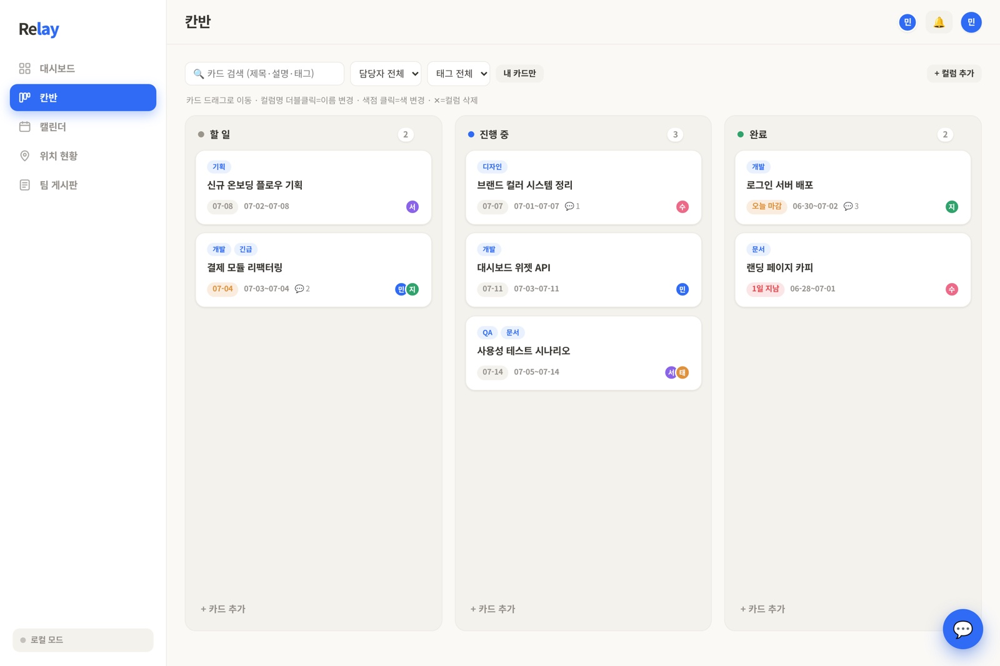
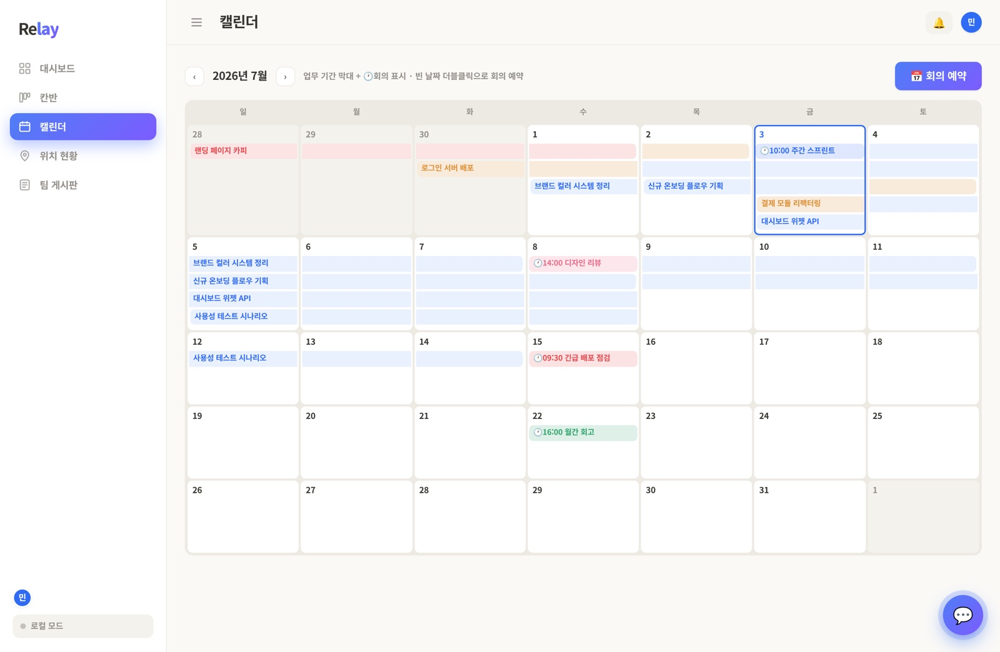
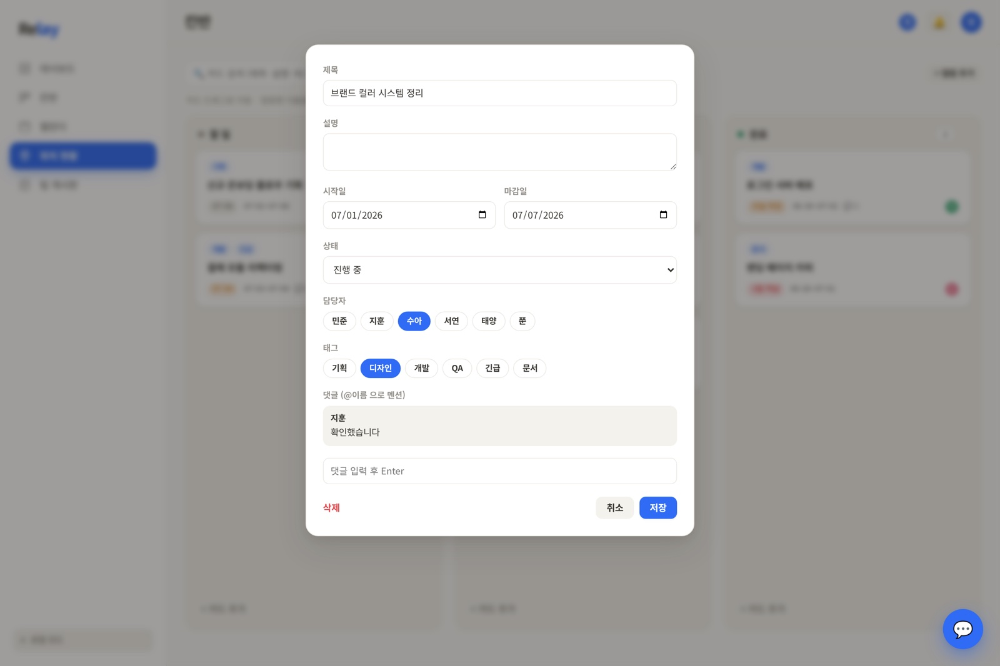
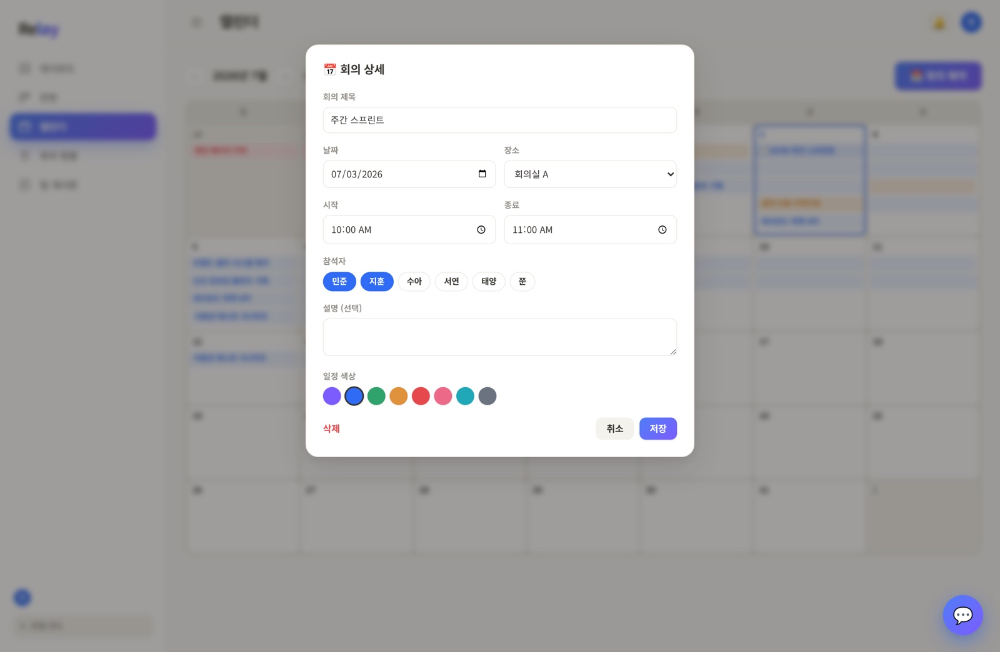

# TeamFlow

A real-time team collaboration web app (dashboard, kanban, calendar, board, meetings, messenger, memos, member locations, and a Gemini-powered assistant), and the record of rebuilding it with **seven Claude Code agents working in parallel**.

<p>
  
  
  
  
</p>

## What is in this repository

| Path | What it is |
|---|---|
| `index.html` | The original single-file app (118 KB) that the agents rebuilt |
| `server.js` | A small Node.js server: real-time sync, saving, and a Gemini proxy (no dependencies) |
| `docs/` | The agents' working documents: `CLAUDE.md` (rules and file ownership), `SPEC.md`, `INTERFACE.md` (shared API contract), `DESIGN.md`, `STATUS.md` (the append-only log), and one task file per worker |
| `screenshots/` | Screens of the app |

The modular code that the agents produced stayed on the Windows machine used in the workshop, so it is not included here. The documents in `docs/` are the actual files the agents worked from.

## How the rebuild worked (July 2026, summer workshop on multi-agent software development)

- **Team**: one lead and six workers (dash, cal, kanban, chat, board, meet), each a Claude Code session in its own tmux pane on WSL2.
- **File ownership**: every agent edits only the files it owns. Workers never open another worker's code.
- **Shared contract**: workers rely only on `INTERFACE.md`; changes to shared files go to the lead as a request.
- **Small contexts**: each worker reads only its task file, its section of `SPEC.md`, and `DESIGN.md`. The 118 KB original is never read whole; the needed excerpts are in the task files.
- **Append-only log**: after each unit of work, an agent commits and appends one line to `STATUS.md` (done/next, a decision, or blocked).
- **Self-verification**: workers checked their own features with jsdom and Playwright.

A real line from `STATUS.md` (translated from Korean):

> **[meet] [notify→lead]** calendar.js and chat.js both declare `esc` in the global scope (no IIFE). When both load, "Identifier 'esc' has already been declared" stops chat.js from running (checked in the console). I don't own these files, so I didn't fix them; wrapping them in an IIFE or prefixing the names would solve it.

**My part**: the workshop provided the tmux scripts and the lead–worker structure. I reviewed and refined the spec files the lead agent drafted (the ownership table, what each worker may read, and the log format), then ran the build and followed the status log.

## Run it

```bash
node server.js            # then open http://localhost:3000
# optional: GEMINI_API_KEY=... node server.js   (enables the AI assistant)
```

Data is saved to `teamflow-data.json` next to the server (ignored by git).

---

**한국어 요약** — 실시간 팀 협업 웹앱(대시보드·칸반·캘린더·게시판·미팅·메신저·메모·위치·AI 어시스턴트)과, 이 앱을 Claude Code 에이전트 7개(리더 1, 작업자 6)가 tmux에서 동시에 나눠 다시 만든 기록이에요. `docs/`에 에이전트들이 실제로 쓴 규칙(파일 소유권), 공유 API 계약, 상태 로그가 그대로 들어 있어요. 에이전트가 만든 모듈 코드는 특강 때 쓴 윈도우 PC에 남아 있어 이 저장소에는 없어요.
